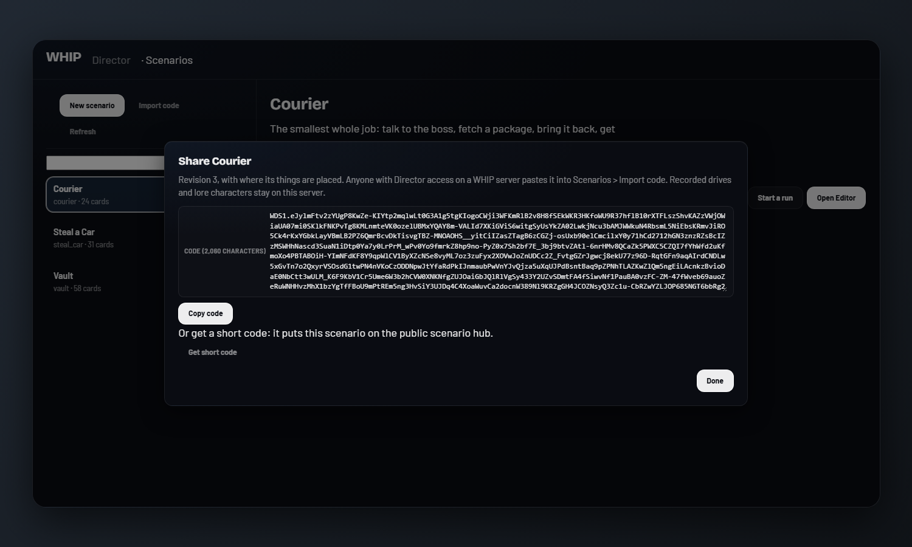
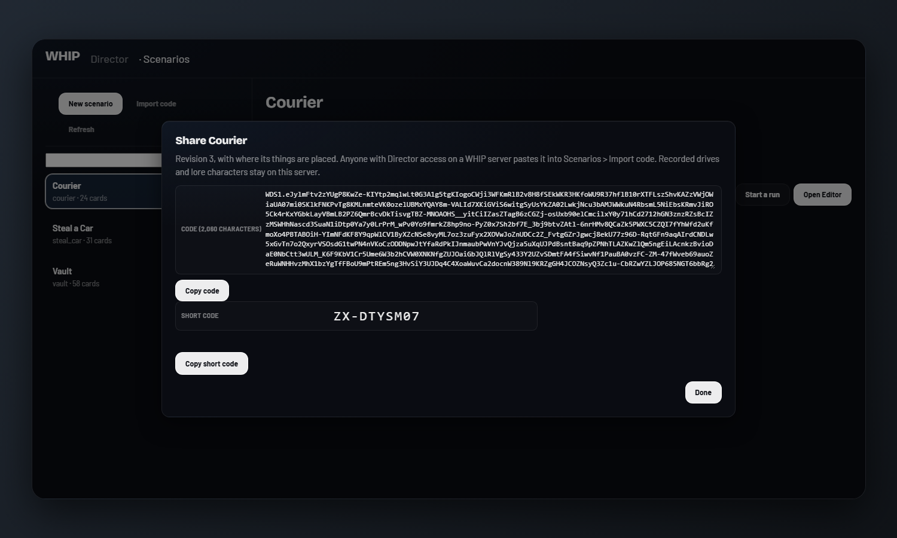
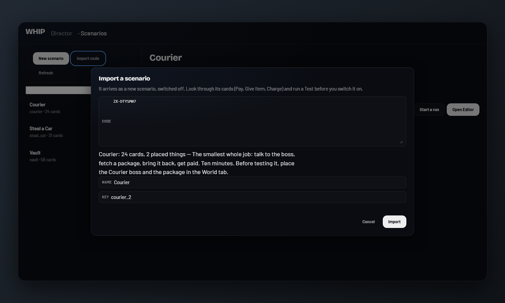
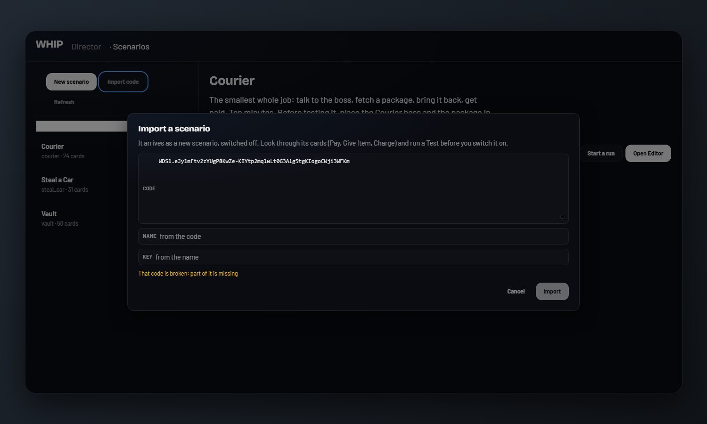

# Zext Scenario Share — for WHIP

**Share WHIP Director scenarios between servers with one code.**

Build a heist, a delivery job or a story in WHIP's Director. Press **Share code** to get a short code like `ZX-4F9K2QH`, or a long code that holds the whole scenario. Anyone on any WHIP server with this add-on pastes it into **Import code**, and the scenario lands in their Director, ready to look over and switch on.

Made by **Zext**. Free to use. This is an unofficial add-on that works with WHIP. It is not made by or part of WHIP.

---

## Contents

- [What it adds](#what-it-adds) ([what it looks like](#what-it-looks-like))
- [Requirements](#requirements)
- [Install](#install)
- [How to use it](#how-to-use-it)
- [Importing from your own resource (exports)](#importing-from-your-own-resource-exports)
- [What a code carries, and what it doesn't](#what-a-code-carries-and-what-it-doesnt)
- [Short codes and the community hub](#short-codes-and-the-community-hub)
- [Updating whip_core, or removing this](#updating-whip_core-or-removing-this)
- [Troubleshooting](#troubleshooting)
- [For developers](#for-developers)
- [License and credits](#license-and-credits)

---

## What it adds

On `/whip` → **Director** → **Scenarios**:

| Where | Button | What it does |
|---|---|---|
| A scenario's page, next to Duplicate | **Share code** | Shows the scenario as a long code (`WDS1.…`) with a **Copy code** button. **Get short code** uploads it to the hub and gives you a short code (`ZX-…`). |
| The toolbar at the top of the list | **Import code** | Paste a short or long code. It shows the scenario's name, its number of cards and placed things, and its description, then makes a **new scenario, switched off**. |
| Your own server scripts | `exports.whip_core:ImportScenarioCode(code)` | The same import, from a resource: ship Director creations with your script as codes. Also `GetScenarioShareCode(key)` to get a code from a script. See [Importing from your own resource](#importing-from-your-own-resource-exports). |

Imports are safe by design:

- **Nothing is overwritten.** Every import is a brand-new scenario with its own key.
- **Nothing switches on by itself.** Imports arrive as drafts. You look them over, Test them, and switch them on yourself.
- **The same checks as the editor's Save.** The scenario is read as plain data and checked by WHIP's own scenario reader. A card the importer isn't allowed to add is refused.
- **Missing pieces are named.** If the scenario uses items or cards your server doesn't have, the import tells you which, so you can swap them in the editor.
- **Only people with Director access** (`director.build`) can share or import in game, the same people who can already build scenarios. Server scripts can import too (they're your own code), with the same checks, and a script can never bring in a permission-gated card.

### What it looks like

*Previews, drawn with whip_core's own panel styles and the add-on's real windows. The Scenarios page behind each window is simplified.*

| Share code | Short code |
|---|---|
|  |  |
| **Import code** | **A broken code is refused** |
|  |  |

---

## Requirements

- A FiveM server running **WHIP** with **whip_core 1.2.0** (the latest) or **1.0.1**. The three files this changes are the same in both versions, so the same files and patch work on either. Check the `version` line in `whip_core/fxmanifest.lua`. Other versions: see [Install, option C](#option-c--other-whip_core-versions-by-hand).
- Director access for the people who'll use it. Give it in `/whip` → Director → Access.
- Nothing else. No extra resource, database table or convar. Short codes use the free community hub out of the box.

---

## Install

This add-on changes three files inside `whip_core`. Pick **one** option.

> **Back up first.** Copy your `whip_core` folder somewhere safe before you start, so you can always go back.

### Option A — drop-in files (easiest)

For **whip_core 1.2.0** or **1.0.1**.

1. Stop your server, or be ready to restart `whip_core`.
2. Open this repository's `whip_core-1.2.0` folder. It holds three files in the same folders they live in inside `whip_core`:
   ```
   whip_core-1.2.0/
   ├── html/js/wp/director.js
   ├── server/director/hub.lua
   └── tools/panel_sections/director.lua
   ```
3. Copy them into your `resources/whip_core` folder (wherever yours is, for example `resources/[whip]/whip_core`) and choose **Replace** for all three.
4. Start the server, or run `restart whip_core` in the server console.
5. Open `/whip` → Director → Scenarios. You should see **Import code** in the toolbar and **Share code** on each scenario. If you don't, see [Troubleshooting](#troubleshooting).

### Option B — apply the patch with git

For **whip_core 1.2.0** or **1.0.1**. Useful if you keep your server in git.

```bash
cd path/to/resources/whip_core
git apply --check path/to/zext-scenario-share/patch/zext-scenario-share-whip_core-1.2.0.patch
git apply path/to/zext-scenario-share/patch/zext-scenario-share-whip_core-1.2.0.patch
```

The first command only checks the patch. If it prints nothing, the second applies it. To take it back out later:

```bash
git apply -R path/to/zext-scenario-share/patch/zext-scenario-share-whip_core-1.2.0.patch
```

Without git, the classic `patch` tool works too: `patch -p1 < zext-scenario-share-whip_core-1.2.0.patch`, run inside `whip_core`.

### Option C — other whip_core versions, by hand

If your whip_core is newer, first try option B with three-way merging:

```bash
git apply -3 path/to/zext-scenario-share-whip_core-1.2.0.patch
```

If that fails, add the changes by hand. Everything this add-on adds is marked `PROJECT Z PATCH` in the three files in `whip_core-1.2.0/`, so search for that text and copy each marked block into the same place in your files:

| File | What to copy | Where it goes |
|---|---|---|
| `server/director/hub.lua` | The whole block from `-- PROJECT Z PATCH: share codes` down to `(end PROJECT Z PATCH)` | Right after the `cb('example', …)` callback |
| `tools/panel_sections/director.lua` | The `shareDoc = { 'key', 'rev' },` line | Inside the `OPS = { … }` table, next to `export` |
| `tools/panel_sections/director.lua` | The `wpDirectorImport` block (starts with `-- PROJECT Z PATCH: Import code`) | Just above `-- Into the world builder on a scenario` |
| `html/js/wp/director.js` | The `Share code` button line | Next to the `Duplicate` button, in `renderDetail()` |
| `html/js/wp/director.js` | The `bar.insertBefore(… 'Import code' …)` line, and the `const bar = listBar(…)` line above it | In the Scenarios section's `render(root)`, replacing the single `split(root, listBar(…))` line |
| `html/js/wp/director.js` | The block from `// PROJECT Z PATCH: share codes` to `(end PROJECT Z PATCH)` | Just above `/** Make one (New scenario, Duplicate) …` |
| `html/js/wp/director.js` | The `wdShare` and `wdImport` lines | In the `actions = { … }` object, after `wdCopy` |

Then `restart whip_core`.

---

## How to use it

### Sharing a scenario

1. Open `/whip` → **Director** → **Scenarios** and click the scenario.
2. Press **Share code**. A window opens with the scenario's long code, already selected.
3. Pick one:
   - **Copy code** copies the long code. It works anywhere, with no internet service involved, and is usually 2,000–30,000 characters. Good for a text file or a Discord file upload.
   - **Get short code** uploads the scenario to the hub and shows a short code like `ZX-4F9K2QH`, with **Copy short code**. Easy to post in chat or say out loud.
4. Press **Done**.

It shares the scenario's **newest saved revision**, including where you placed its NPCs, cars and props.

> Getting a short code **publishes** the scenario. Anyone who has the code can download it. Don't put anything private in a scenario you share this way.

### Importing a scenario

1. Open `/whip` → **Director** → **Scenarios** and press **Import code** in the toolbar.
2. Paste the code, short (`ZX-…`) or long (`WDS1.…`). Spaces and line breaks in a pasted code are ignored.
3. Check the line it shows: the scenario's name, how many cards and placed things it has, and its description.
4. Change **Name** and **Key** if you like. The key must be new on your server. If the name is taken, a free one is suggested.
5. Press **Import**. The new scenario opens in the list, switched off.

### Before you switch an import on

An imported scenario was built by someone else, on another server. Before players get it:

1. **Open Editor** and press **Check**. It lists anything that won't work here: items you don't have, other resources' cards, lore characters.
2. **Look at the money and items.** Read every **Pay**, **Give Item**, **Give Car** and **Charge Player** card so the rewards suit your economy.
3. **Look at where things are placed.** Positions are GTA map coordinates. If the scenario sits inside an MLO interior you don't have, move those things in the world builder.
4. **Test** it yourself. Tests hand out nothing that lasts.
5. Switch it on.

---

## Importing from your own resource (exports)

Other resources can import Director creations too. This is handy when you sell or share a script that comes with missions: put the scenario's code in your resource, and it lands in the server's Director when your script starts. These are **server-side** exports.

### `ImportScenarioCode(code, opts?)`

```lua
local ok, result = exports.whip_core:ImportScenarioCode(code, { key = 'my_heist', name = 'Bank Job' })
```

| Argument | What it is |
|---|---|
| `code` | Any of: a short code (`ZX-DTYSM07`), a long code (`WDS1.…` or `WDS0.…`), a scenario's JSON text, or a scenario as a Lua table. |
| `opts.key` | *Optional.* The key to save it under. If that key is taken, the import is refused, never written over. Leave it out and a key is made from the scenario's own key or name, with `_2`, `_3`… on the end when taken, the same as the Import code button. |
| `opts.name` | *Optional.* The name shown in the Director. Defaults to the scenario's own name. |

It returns `true, { key, name, missing }` or `false, "why"`. `missing` is `{ items = {...}, cards = {...} }`: things the scenario uses that this server doesn't have.

It **waits** (for the Director to finish loading after a restart, up to 20 seconds; for the hub, if you gave a short code; and for the database), so call it from a thread such as `CreateThread`.

Exactly like **Import code** in game, the result is a **new scenario, switched off**. An admin still looks it over and switches it on. A script has no player permissions, so a scenario containing a permission-gated card is refused. The server console prints which resource imported what.

**Example: import once, the first time your resource starts.** Keep the code in a file in your resource (so a long code doesn't clutter your Lua):

```lua
-- fxmanifest.lua
server_script 'server.lua'
files { 'scenarios/bank_job.txt' }
dependency 'whip_core'
```

```lua
-- server.lua
CreateThread(function()
    local code = LoadResourceFile(GetCurrentResourceName(), 'scenarios/bank_job.txt')
    local ok, result = exports.whip_core:ImportScenarioCode(code, { key = 'bank_job' })
    if ok then
        print(('Bank Job added to the Director as %s: an admin needs to switch it on'):format(result.key))
        if #result.missing.items > 0 then print('  This server is missing items: ' .. table.concat(result.missing.items, ', ')) end
    elseif result:find('is taken') then
        -- Imported on an earlier start: nothing to do.
    else
        print('Bank Job could not be added: ' .. result)
    end
end)
```

Naming a fixed `key` is what makes "import once" work: the second start finds the key taken and does nothing, so an admin's edits are never lost.

> A short code (`ZX-…`) needs the hub to be online when your script runs. For anything you ship to other people, use the **long code**: it works offline, forever.

### `GetScenarioShareCode(key, rev?)`

```lua
local code, why = exports.whip_core:GetScenarioShareCode('bank_job')
```

Returns the scenario's long code (newest saved revision, or `rev` if given), or `false, "why"`. The code starts with `WDS0.` (not compressed, so it's longer than one from the Share code button), and works with **Import code** and `ImportScenarioCode` on any server with this add-on. Use it for backups, or to put a server's scenario into your resource.

---

## What a code carries, and what it doesn't

| Carried | Not carried (stays on the server that made it) |
|---|---|
| All cards, wires, settings and variables | **Recorded drives** (Takes): record them again on your server |
| All placed things and where they are | **Lore characters**: make ones with the same keys, or pick yours on the cards |
| Every variant (Multi Run Variants) | Its run history, stats and previous versions |
| NPC outfits, tasks, routes, guard sight | Data other resources' Director buttons saved, if those resources aren't on your server |

A code is limited to 512 KB of scenario once unpacked, which is WHIP's own limit for a scenario file.

---

## Short codes and the community hub

Long codes need nothing but the add-on. **Short codes** need a small online service, the **hub**, to look the long code up. Out of the box this add-on uses the free community hub run by Zext:

```
https://zext-scenario-hub.whipshare.workers.dev
```

- **Anyone with this add-on can upload.** There's a limit of 20 uploads an hour per internet address to stop spam.
- **Codes never change.** The same scenario always gets the same short code, and nobody can edit or overwrite yours.
- **Uploads are checked.** Only real scenario codes are accepted, up to 512 KB unpacked. Junk is refused.
- **Privacy.** The hub stores the scenario, its name and description, its card and thing counts, and an upload time. It does **not** store your IP address, only a scrambled one-way fingerprint of it, used for the hourly limit. Uploads come from the builder's game.
- **Takedowns.** If someone shared something that shouldn't be there, open an issue on this repository with the short code.
- **No guarantee.** It's a free community service. If it's ever down, long codes keep working.

### Use your own hub instead

You can run your own copy for free on Cloudflare. See [`hub/README.md`](hub/README.md). Then change one line at the top of the share-code block in `whip_core/html/js/wp/director.js`:

```js
const HUB_URL = 'https://zext-scenario-hub.whipshare.workers.dev';
```

Put your own hub's address there, with no slash at the end. Scripts using `ImportScenarioCode` look short codes up separately, so also add this to your `server.cfg`:

```
set zext_share_hub "https://your-hub.your-name.workers.dev"
```

Then `restart whip_core`. Servers only see each other's short codes when they use the same hub, but long codes always work between any of them.

### Turn short codes off

Set `const HUB_URL = '';` in `director.js`, and `set zext_share_hub ""` in `server.cfg`. **Get short code** disappears, imports take only long codes, and neither the game nor the server contacts the hub.

---

## Updating whip_core, or removing this

**Updating whip_core overwrites these three files**, and the buttons disappear. Your scenarios, including imported ones, are untouched because they live in your database. After updating:

- If the new whip_core is **1.2.0** (or 1.0.1), re-copy the drop-in files (option A).
- If it's a newer version, use option C, or check this repository for a newer release.

**To remove the add-on**, put back the three original files from your backup, or run `git apply -R …` (option B), then `restart whip_core`. Scenarios you imported stay. They're ordinary scenarios.

---

## Troubleshooting

| Problem | Fix |
|---|---|
| No **Share code** or **Import code** button | The files aren't in the right `whip_core` folder, or whip_core wasn't restarted. Check the three paths, then `restart whip_core`. Players with the panel already open need to close and reopen it. |
| "unknown request" when pressing Share code | `tools/panel_sections/director.lua` wasn't replaced. Copy it again. |
| "No answer from the server" on Share or Import | `server/director/hub.lua` wasn't replaced, or the server console shows an error from it. Copy it again and restart. |
| "That is not a scenario code" | The code is cut off or wasn't copied whole. Long codes start with `WDS1.` or `WDS0.`, short codes with `ZX-`. |
| "The scenario hub cannot be reached" | The hub is down or blocked from your network. Use the long code instead. |
| "Too many uploads from here" | 20 short codes an hour per address. Wait an hour, or share the long code. |
| "… is taken: pick another key" | A scenario with that key already exists. Change **Key** in the import window. |
| "Imported, but this server has no items: …" | Add those items to your server, or open the scenario's editor and pick items you do have. |
| Imported scenario won't switch on | Open its editor and press **Check**. It lists what to fix: missing lore characters, missing cards, unplaced things. |
| "This game cannot unpack that code" | The player's FiveM is very old. Update FiveM. |
| "No such export ImportScenarioCode" | `server/director/hub.lua` is an older copy, or your resource started before whip_core. Copy the file again and add `dependency 'whip_core'` to your resource's `fxmanifest.lua`. |
| `ImportScenarioCode` says "The Director is still starting" | It already waits up to 20 seconds for the Director to load. If you still see this, the database is slow or down: check the server console for whip_core errors. |

---

## For developers

### The code format

```
WDS1.<base64url( deflate( JSON scenario document ) )>
WDS0.<base64url( JSON scenario document )>      (no compression: fallback)
```

The JSON is exactly what the Director editor saves (`"format": 2`), plus `key` (a suggested key) and `requires` (items, models and cards it uses). Deflate is zlib-wrapped (`CompressionStream('deflate')`). Short codes are `ZX-` and 7 Crockford base32 characters.

### Hub API

| Request | Answer |
|---|---|
| `POST /v1/codes`, body = a long code as text | `201 { id, name, cards, things, existed:false }`, or `200 { …, existed:true }` if it was already stored |
| `GET /v1/codes/ZX-XXXXXXX` (dash optional, any case) | `200 { id, code, name, description, cards, things, createdAt }`, or `404` |
| `DELETE /v1/codes/ZX-XXXXXXX` with `Authorization: Bearer <ADMIN_TOKEN>` | `200 { removed }`, for the hub's owner |

Errors are `{ "error": "words to show" }`. CORS is open, so a page or tool can call it directly.

### What changed in whip_core

- `server/director/hub.lua`: two Director callbacks, `shareDoc` (builder permission: the newest revision as a document) and `importCode` (builder permission: takes an uploaded document and makes a new draft with `DirectorStore.create`, after `gatedChange`). Imports reuse whip_core's own latent upload, `whip_core:server:directorDoc`, which copies the document as plain data and loads it with `DirectorDoc.load`. Two server exports, `ImportScenarioCode` and `GetScenarioShareCode`, do the same from scripts: the server unpacks `WDS1.` codes with its own small inflate (capped at 512 KB, so a tiny code can't unpack into a huge one) and looks short codes up with `PerformHttpRequest` at the `zext_share_hub` convar.
- `tools/panel_sections/director.lua`: the `shareDoc` op, and a `wpDirectorImport` NUI callback that uploads the document and calls `importCode`.
- `html/js/wp/director.js`: the buttons, the two windows, packing and unpacking codes in the page, and the hub requests.

---

## License and credits

- **The whip_core changes** (`whip_core-1.2.0/` and `patch/`) are modified files of whip_core. Like whip_core, they're under the **GNU Lesser General Public License 3.0** (`COPYING.LESSER`, with the GPL 3.0 it builds on in `COPYING`). WHIP and whip_core are © Whippy. See WHIP's own `NOTICE.md`.
- **The hub** (`hub/`) is Zext's own code, under the **MIT License** (`hub/LICENSE`).
- "WHIP" is used only to say what this works with. This add-on is not WHIP and isn't endorsed by WHIP's author.

Made by **Zext**.
