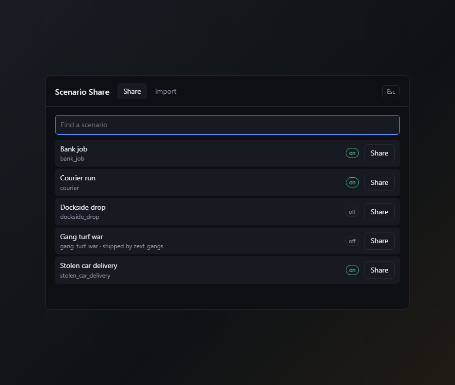
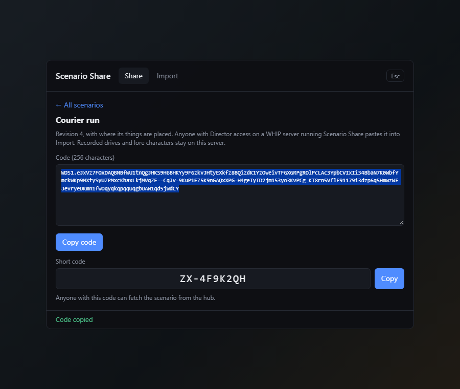
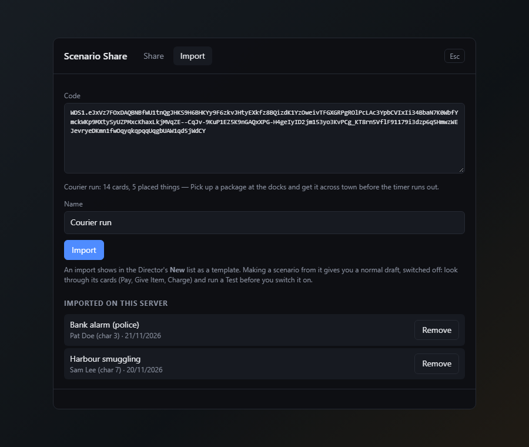

# Zext Scenario Share — for WHIP

**Share WHIP Director scenarios between servers with one code.**

Build a heist, a delivery job or a story in WHIP's Director. Open **/scenarioshare**, press **Share**, and you get a long code that holds the whole scenario, or a short code like `ZX-4F9K2QH`. Anyone on another WHIP server with this resource pastes the code into **Import**. The scenario then shows up in their Director's **New** list, ready to look over and make their own.

It's a normal resource: drop it in and `ensure` it. **It doesn't edit whip_core**, so WHIP updates never break it.

Made by **Zext**. Free to use. This is an unofficial add-on that works with WHIP. It isn't made by WHIP or part of it.

> Coming from 1.x (the whip_core patch)? See [Upgrading from 1.x](#upgrading-from-1x).

---

## Contents

- [What it adds](#what-it-adds) ([what it looks like](#what-it-looks-like))
- [Requirements](#requirements)
- [Install](#install)
- [How to use it](#how-to-use-it)
- [Exports (for other resources)](#exports-for-other-resources)
- [What a code carries, and what it doesn't](#what-a-code-carries-and-what-it-doesnt)
- [Short codes and the community hub](#short-codes-and-the-community-hub)
- [Upgrading from 1.x](#upgrading-from-1x)
- [Troubleshooting](#troubleshooting)
- [For developers](#for-developers)
- [License and credits](#license-and-credits)

---

## What it adds

| Where | What it does |
|---|---|
| **/scenarioshare → Share** | Lists your server's scenarios. **Share** on one shows it as a long code (`WDS1.…`) with **Copy code**. **Get short code** puts it on the hub and gives you a short code (`ZX-…`). |
| **/scenarioshare → Import** | Paste a short or long code. It shows the scenario's name, its number of cards and placed things, and its description. **Import** adds it to the Director's **New** list as a template. |
| **Director → New** | Each import is a template there. Picking it makes an ordinary draft scenario, switched off, that you edit, Test and switch on as usual. |
| Server scripts | `exports.zext_scenario_share:ImportScenarioCode(code)` and `GetScenarioShareCode(key)`. See [Exports](#exports-for-other-resources). |

Imports are safe by design:

- **Nothing is overwritten.** An import is a template, and a scenario made from it is a brand-new draft.
- **Nothing switches on by itself.** A builder makes a draft from the template, looks it over, Tests it and switches it on.
- **WHIP's own checks.** The Director reads every import with its own scenario reader and refuses anything that isn't a valid scenario. A permission-gated card is refused in a builder's copy.
- **Problems are named.** If WHIP's Check finds problems (items or cards your server doesn't have), the import lists them so you can fix them in the editor.
- **Only Director builders** (WHIP permission `director.build`) can open /scenarioshare: the same people who can already build scenarios.

### What it looks like

| Share | A code | Import |
|---|---|---|
|  |  |  |

---

## Requirements

- A FiveM server running **WHIP** (whip_core 1.2.0 or newer).
- **oxmysql**, which every WHIP server already has.
- Director access for the people who'll use it. Give it in `/whip` → Director → Access.

---

## Install

1. Download the latest release and put the `zext_scenario_share` folder in your `resources` folder. A folder group like `[addons]` works too.
2. Add `ensure zext_scenario_share` to `server.cfg`, **after** WHIP's lines.
3. Start the server, or run `ensure zext_scenario_share` in the console.

On first start it makes one table of its own, `zext_scenario_share_imports`, and changes nothing else.

---

## How to use it

### Sharing a scenario

1. Type **/scenarioshare**. The **Share** tab lists every scenario on the server. Type in the box to find one.
2. Press **Share** on the scenario. Its long code appears, already selected.
3. Pick one:
   - **Copy code** copies the long code. It works anywhere, with no internet service involved, and is usually 2,000–30,000 characters. Good for a text file or a Discord file upload.
   - **Get short code** uploads the scenario to the hub and shows a short code like `ZX-4F9K2QH` with **Copy**. Easy to post in chat or say out loud.

It shares the scenario's **newest saved revision**, including where you placed its NPCs, cars and props. A scenario loaded with `/director load` and never saved can't be shared: save it first.

> Getting a short code **publishes** the scenario. Anyone who has the code can download it. Don't put anything private in a scenario you share this way.

### Importing a scenario

1. Type **/scenarioshare** and open the **Import** tab.
2. Paste the code, short (`ZX-…`) or long (`WDS1.…`). Spaces and line breaks are ignored.
3. Check the line it shows: the scenario's name, how many cards and placed things it has, and its description.
4. Change **Name** if you like, then press **Import**.
5. Open `/whip` → **Director** and press **New**. The import is in the list under its name. Picking it makes your own draft.

**Imported on this server** lists every import with who added it. **Remove** takes it out of the New list. Scenarios already made from it stay.

### Before you switch an import on

An imported scenario was built by someone else, on another server. Before players get it:

1. **Open Editor** and press **Check**. It lists anything that won't work here: items you don't have, other resources' cards, lore characters.
2. **Look at the money and items.** Read every **Pay**, **Give Item**, **Give Car** and **Charge Player** card so the rewards suit your economy.
3. **Look at where things are placed.** Positions are GTA map coordinates. If the scenario sits inside an MLO interior you don't have, move those things in the world builder.
4. **Test** it yourself. Tests hand out nothing that lasts.
5. Switch it on.

---

## Exports (for other resources)

Server-side. Handy when you ship a script that comes with missions: put the scenario's code in your resource, and it shows up in the server's Director when your script starts.

### `ImportScenarioCode(code, opts?)`

```lua
local ok, result = exports.zext_scenario_share:ImportScenarioCode(code, { name = 'Bank Job' })
```

| Argument | What it is |
|---|---|
| `code` | Any of: a short code (`ZX-DTYSM07`), a long code (`WDS1.…` or `WDS0.…`), a scenario's JSON text, or a scenario as a Lua table. |
| `opts.name` | *Optional.* Its name in the Director's New list. Defaults to the scenario's own name, with `(2)`, `(3)`… added when an import already uses it. |

It returns `true, { name, problems }` or `false, "why"`. `problems` lists what WHIP's Check found (missing items or cards).

It **waits** (up to 20 seconds for this resource to finish starting; for the hub, if you gave a short code; and for the database), so call it from a thread. Add `dependency 'zext_scenario_share'` to your resource.

Each call adds another import, so import once and remember that you did (for example, in a KVP):

```lua
CreateThread(function()
    if GetResourceKvpInt('bank_job_imported') == 1 then return end
    local code = LoadResourceFile(GetCurrentResourceName(), 'scenarios/bank_job.txt')
    local ok, result = exports.zext_scenario_share:ImportScenarioCode(code, { name = 'Bank Job' })
    if ok then
        SetResourceKvpInt('bank_job_imported', 1)
        print(('Bank Job is in the Director\'s New list as "%s"'):format(result.name))
    else
        print('Bank Job could not be added: ' .. result)
    end
end)
```

> For a scenario you only ship (players never edit the original), WHIP's own `whip_director_scenario 'file.json'` manifest line, or `Whip.scenario`, may suit you better. This export is for codes.

### `GetScenarioShareCode(key, rev?)`

```lua
local code, why = exports.zext_scenario_share:GetScenarioShareCode('bank_job')
```

Returns the scenario's long code (its newest saved revision, or `rev` if given), or `false, "why"`. The code starts with `WDS0.` (not compressed, so it's longer than one from the screen) and imports anywhere. Use it for backups, or to put a server's scenario into your resource.

---

## What a code carries, and what it doesn't

| Carried | Not carried (stays on the server that made it) |
|---|---|
| All cards, wires, settings and variables | **Recorded drives** (Takes): record them again on your server |
| All placed things and where they are | **Lore characters**: make ones with the same keys, or pick yours on the cards |
| Every variant (Multi Run Variants) | Its run history, stats and previous versions |
| NPC outfits, tasks, routes, guard sight | Data that other resources' Director buttons saved, if those resources aren't on your server |

A code is limited to 512 KB of scenario once unpacked, which is WHIP's own limit for a scenario file.

---

## Short codes and the community hub

Long codes need nothing but this resource. **Short codes** need a small online service, the **hub**, to look up the long code. Out of the box this resource uses the free community hub run by Zext:

```
https://zext-scenario-hub.whipshare.workers.dev
```

- **Anyone can upload.** There's a limit of 20 uploads an hour per internet address to stop spam.
- **Codes never change.** The same scenario always gets the same short code, and nobody can edit or overwrite yours.
- **Uploads are checked.** Only real scenario codes are accepted, up to 512 KB unpacked. Junk is refused.
- **Privacy.** The hub stores the scenario, its name and description, its card and thing counts, and an upload time. It does **not** store your IP address, only a scrambled one-way fingerprint of it, used for the hourly limit. Uploads come from the builder's game.
- **Takedowns.** If someone shared something that shouldn't be there, open an issue on this repository with the short code.
- **No guarantee.** It's a free community service. If it's ever down, long codes keep working.

### Use your own hub, or none

Run your own copy for free on Cloudflare: see [`hub/README.md`](hub/README.md). Then in `server.cfg`:

```
set zext_share_hub "https://your-hub.your-name.workers.dev"
```

Use `set zext_share_hub ""` to turn short codes off: **Get short code** disappears, imports take only long codes, and nothing contacts the hub. Servers only see each other's short codes when they use the same hub, but long codes always work between any of them.

---

## Upgrading from 1.x

Versions 1.x patched three files inside whip_core. 2.0 is a separate resource instead:

1. Put back whip_core's own `server/director/hub.lua`, `tools/panel_sections/director.lua` and `html/js/wp/director.js`. Use your backup, a fresh whip_core download, or `git apply -R` with the old patch.
2. Install this resource ([Install](#install)).

Scenarios you imported with 1.x stay, because they're ordinary scenarios. The `zext_share_hub` convar works the same. Scripts that called `exports.whip_core:ImportScenarioCode` now call `exports.zext_scenario_share:ImportScenarioCode`. An import now becomes a template in the New list rather than a draft, and `opts.key` is gone because templates go by name.

The old patch is still available in the [v1.1.1 release](https://github.com/ZextEU/zext-scenario-share/releases/tag/v1.1.1).

---

## Troubleshooting

| Problem | Fix |
|---|---|
| "/scenarioshare" does nothing | The resource isn't started. Check `ensure zext_scenario_share` and the server console. |
| "Scenario Share is for Director builders" | Your account needs `director.build`. Get it from `/whip` → Director → Access. |
| "… is not a stored scenario" | It was loaded with `/director load` and never saved. Save it in the Director first. |
| "That is not a scenario code" | The code is cut off or wasn't copied whole. Long codes start with `WDS1.` or `WDS0.`, short codes with `ZX-`. |
| "The scenario hub cannot be reached" | The hub is down or blocked from your network. Use the long code instead. |
| "Too many uploads from here" | 20 short codes an hour per address. Wait an hour, or share the long code. |
| "The Director refused it: …" | WHIP's scenario reader says it isn't a scenario this Director can read (for example, one made for a much newer WHIP). Update whip_core. |
| Import says Check found problems | Add those items to your server, or make a draft from the template and swap them in the editor. |
| The import isn't in Director → New | Close and reopen the Director. If it's still missing, the server console prints why it was refused. |
| "This game cannot unpack that code" | The player's FiveM is very old. Update FiveM. |

---

## For developers

### The code format

```
WDS1.<base64url( deflate( JSON scenario document ) )>
WDS0.<base64url( JSON scenario document )>      (no compression: fallback)
```

The JSON is exactly what the Director editor saves, plus `key` (the sharer's key, as a suggestion). Deflate is zlib-wrapped (`CompressionStream('deflate')`). Short codes are `ZX-` and 7 Crockford base32 characters. The format is the same as 1.x, so codes made with either version import into the other.

### How it works without core edits

- **Share** reads the scenario's revision from the Director's own tables, read-only (`director_scenarios` and `director_revisions`). whip_core has no export that hands out a whole scenario document: `GetScenario` returns a summary.
- **Import** uses WHIP's public `Whip.template` path (`__RegisterDirectorTemplate`) after `CheckDirectorScenario`. Imports are kept in `zext_scenario_share_imports` and offered again whenever whip_core starts, because WHIP forgets templates when it restarts.
- **The screen** is the resource's own NUI page, opened with `SetScreenOpen`. A code goes up to the server in 7,000-character pieces through `SecureCallback`s gated on `director.build`, because a large plain client-to-server message never arrives. The server unpacks it with its own small inflate (capped at 512 KB, so a tiny code can't unpack into a huge one).

### Hub API

| Request | Answer |
|---|---|
| `POST /v1/codes`, body = a long code as text | `201 { id, name, cards, things, existed:false }`, or `200 { …, existed:true }` if it was already stored |
| `GET /v1/codes/ZX-XXXXXXX` (dash optional, any case) | `200 { id, code, name, description, cards, things, createdAt }`, or `404` |
| `DELETE /v1/codes/ZX-XXXXXXX` with `Authorization: Bearer <ADMIN_TOKEN>` | `200 { removed }`, for the hub's owner |

Errors are `{ "error": "words to show" }`. CORS is open, so a page or tool can call it directly.

---

## License and credits

- **The resource** (`zext_scenario_share/`) and **the hub** (`hub/`) are Zext's own code, under the **MIT License** (`LICENSE`, `hub/LICENSE`).
- It runs alongside WHIP and calls whip_core's public exports. It contains no WHIP code. WHIP and whip_core are © Whippy.
- "WHIP" is used only to say what this works with. This resource isn't WHIP and isn't endorsed by WHIP's author.

Made by **Zext**.
